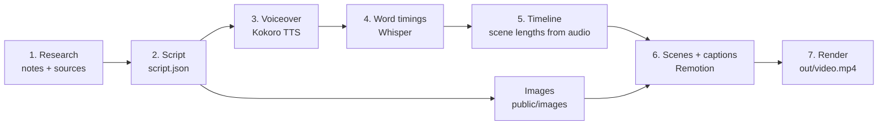

# History Video Studio

**Turn a written script into a finished, narrated documentary-style video, entirely from code, with no camera, no face on screen, and no AI video-generation credits.**

You write (or generate) a script. The project then creates the voiceover, times the captions to each spoken word, animates your reference images, and renders a ready-to-upload MP4. Everything runs on your own computer, and the tools are free.

> Built for **faceless history, politics and explainer channels**, but it works for any narrated, image-driven video: science, economics, biographies, news explainers, course lessons.

---

## Table of contents

1. [What is this project, in simple terms?](#what-is-this-project-in-simple-terms)
2. [Why does it exist? (the agenda)](#why-does-it-exist-the-agenda)
3. [What you get](#what-you-get)
4. [Use cases](#use-cases)
5. [How it works: the flow](#how-it-works-the-flow)
6. [Tools used, and what each one is for](#tools-used-and-what-each-one-is-for)
7. [Project structure](#project-structure)
8. [Quick start](#quick-start)
9. [Make your own video](#make-your-own-video)
10. [Customising](#customising)
11. [Content guidelines (accuracy, images, AI disclosure)](#content-guidelines-accuracy-images-ai-disclosure)
12. [Troubleshooting](#troubleshooting)
13. [Roadmap](#roadmap)
14. [Licences and credits](#licences-and-credits)

---

## What is this project, in simple terms?

Most AI video tools generate a few seconds of footage at a time and charge credits for each clip. This project takes a different approach.

A video is just **pictures + sound + text, changing over time**. If you can describe each frame in code, a computer can draw all the frames and stitch them into a video, however long it is. So:

- **The voice** comes from a free, offline text-to-speech model.
- **The captions** are timed to the exact spoken words by a free, offline speech-recognition model.
- **The pictures** are real reference images (maps, paintings, photos, documents) that you collect, animated with slow zooms and pans, like a documentary.
- **The assembly and look** (animation, captions, film grain, vignette) are done with code, using a tool called Remotion.

Length is limited only by your script. A 1-minute short, a 10-minute explainer, or a 1-hour documentary all use the same pipeline.

## Why does it exist? (the agenda)

- **No generation limits.** No "10 seconds per clip" and no credits running out.
- **Faceless and private.** You never appear on camera. You can use an AI voice, or later your own recorded voice.
- **Consistent, brandable look.** Every video shares the same fonts, colours, caption style and film look because they come from the same code.
- **Repeatable.** Once the scene types exist, a new video is mostly a new script and a new set of images.
- **Accuracy first.** Script, sources and image licences live in the project folder, so every video can be fact-checked and credited.
- **Own your pipeline.** Free and open-source tools, running locally, with nothing locked behind a subscription.

## What you get

- A **script file** (`script.json`) that describes every scene: what is said and what is shown.
- **Voiceover** generated per scene, so each scene's length automatically follows the audio.
- **Word-by-word highlighted captions** timed to the voice.
- **Animated scenes**: Ken Burns zoom and pan on images, fade-ins, on-screen labels (such as "Rome, 133 BC").
- A **cinematic overlay**: film grain and vignette on every scene.
- A **live preview** in the browser, and a one-command **MP4 render** at 1080p or 4K.
- Folders for **research notes, sources and image credits**, so the work is traceable.

## Use cases

| Use case | Example |
|---|---|
| **History explainers** | "Why the Roman Republic collapsed", "How the Cold War began" |
| **Political and policy explainers** | How a law passed, how an electoral system works (with sources shown) |
| **Biographies and timelines** | The life of a leader, scientist or artist, shown through period images |
| **Education and course videos** | Lessons narrated over slides, maps and diagrams |
| **Documentary-style shorts** | 30–90 second vertical clips for Shorts, Reels and TikTok |
| **News and current-affairs explainers** | Narration over charts, maps and quotes |
| **Faceless channel automation** | A repeatable weekly workflow: research → script → video |

## How it works: the flow



| Step | What happens | Command |
|---|---|---|
| 1. Research | You collect facts and sources in `research/sources.md`. | (manual) |
| 2. Script | You write `script.json`: each scene has narration text and a visual. | (manual or with an LLM) |
| 3. Voiceover | Kokoro reads each scene's narration and saves one audio file per scene. | `python scripts/make_voice.py` |
| 4. Word timings | Whisper listens to each audio file and records when every word is spoken. | `python scripts/make_captions.py` |
| 5. Timeline | The scripts measure each audio file and set each scene's length to match. | `python scripts/build_timeline.py` |
| 6. Preview | Remotion draws the animated scenes with captions, live in your browser. | `npm run studio` |
| 7. Render | Remotion renders every frame and writes the final video. | `npm run render` |

## Tools used, and what each one is for

| Tool | What it does here | Why this one | Cost |
|---|---|---|---|
| **[Remotion](https://www.remotion.dev)** (React + Node.js) | Draws every frame (animation, captions, overlays) and renders the MP4 | Lets you build video with web technology and code; includes its own ffmpeg | Free for individuals and companies of up to 3 people ([licence terms](https://www.remotion.dev/docs/license/terms)) |
| **[Kokoro-82M](https://huggingface.co/hexgrad/Kokoro-82M)** (Python) | Text-to-speech voiceover | Small, fast, good quality, runs on a normal CPU, Apache 2.0 licence | Free, offline |
| **[faster-whisper](https://github.com/SYSTRAN/faster-whisper)** (Python) | Speech recognition to get word-level timings for captions | Accurate timings, runs on CPU | Free, offline |
| **Python 3.12** | Runs the voice, caption and timeline scripts | Required by Kokoro's dependencies (3.13 is too new) | Free |
| **Node.js 20+** | Runs Remotion | Remotion's runtime | Free |
| **soundfile / NumPy** | Read audio files and measure their lengths | Lightweight audio handling | Free |
| **An LLM of your choice** (optional) | Helps research, structure the script and write scene lists | Saves time. Facts must still be checked against your sources | Varies |
| **Music** (optional) | Background score in `public/music` | Royalty-free library or your own generated music | Varies |

## Project structure

```
history-video-studio/
├── script.json              # THE INPUT: scenes, narration, visuals
├── research/
│   └── sources.md           # facts + where they came from
├── public/
│   ├── images/              # reference images (+ credits.json for licences)
│   ├── audio/               # generated voiceover, one file per scene
│   ├── captions/            # generated word timings, one file per scene
│   └── music/               # optional background music
├── scripts/
│   ├── make_voice.py        # script.json  -> audio (Kokoro)
│   ├── make_captions.py     # audio        -> word timings (Whisper)
│   └── build_timeline.py    # audio + timings -> src/timeline.json
├── src/                     # the video itself (Remotion / React)
│   ├── Main.tsx             # puts scenes, audio, captions, overlay together
│   ├── scenes/ImageZoom.tsx # Ken Burns zoom/pan scene
│   ├── Captions.tsx         # highlighted word-by-word captions
│   ├── Overlay.tsx          # film grain + vignette
│   └── timeline.json        # generated: scene lengths and timings
├── out/                     # finished videos (git-ignored)
├── package.json             # Node/Remotion dependencies and commands
└── requirements.txt         # Python dependencies
```

## Quick start

A small **sample project is included** (three placeholder scenes, with voice and captions already generated), so you can preview and render it right after the Node setup, before installing any Python.

### 1. Install the basics

- [Node.js 20 or newer](https://nodejs.org)
- [Python **3.12**](https://www.python.org/downloads/) (3.13 and newer do not work yet with Kokoro's dependencies)
- [Git](https://git-scm.com)

You do **not** need to install ffmpeg or espeak-ng separately: Remotion bundles ffmpeg, and Kokoro installs its own speech engine.

### 2. Get the code and install Node packages

```bash
git clone https://github.com/JakkawarRajesh/history-video-studio.git
cd history-video-studio
npm install
```

### 3. Preview and render the sample (no Python needed yet)

```bash
npm run studio     # opens http://localhost:3000, pick "Main" and press play
npm run render     # writes out/video.mp4
```

### 4. Set up Python for making your own videos

**Windows**

```bat
py -3.12 -m venv .venv
.venv\Scripts\activate
pip install -r requirements.txt
```

**macOS / Linux**

```bash
python3.12 -m venv .venv
source .venv/bin/activate
pip install -r requirements.txt
```

The install is large (PyTorch is the biggest part) and can take several minutes. On first use, Kokoro downloads its voice model (about 330 MB) and Whisper downloads its "small" model (about 480 MB). Activate the environment (`.venv\Scripts\activate` or `source .venv/bin/activate`) every time you open a new terminal before running the Python scripts.

## Make your own video

1. **Research.** Put key passages and where they came from in `research/sources.md`. Only use facts you can source.
2. **Write the script.** Edit `script.json`:

   ```json
   {
     "title": "Why the Roman Republic Collapsed",
     "fps": 30,
     "voice": "am_michael",
     "scenes": [
       {
         "id": 1,
         "narration": "In one hundred thirty three B C, a single tribune dared to challenge the richest men in Rome.",
         "visual": { "type": "ImageZoom", "image": "images/forum.jpg", "zoom": "in", "label": "Rome, 133 BC" }
       }
     ]
   }
   ```

   - Keep each scene to 2–4 sentences (roughly 6–12 seconds).
   - Write numbers and names the way they should be **spoken** ("one hundred thirty three", "Grack-us").
   - `zoom` can be `in`, `out`, `pan-left` or `pan-right`. `label` is optional.
3. **Add images** to `public/images/` (highest resolution you can legally use) and record the licence of each in `public/images/credits.json`.
4. **Generate voice, captions and timeline:**

   ```bash
   python scripts/make_voice.py
   python scripts/make_captions.py
   python scripts/build_timeline.py
   ```

   To redo only some scenes, pass their numbers: `python scripts/make_voice.py 3 7` (same for `make_captions.py`), then run `build_timeline.py` again.
5. **Preview:** `npm run studio`
6. **Render:** `npm run render` for 1080p, or `npm run render4k` for a sharper 4K export. Both write to `out/`.

## Customising

- **Voice and speed:** change `"voice"` in `script.json` (Kokoro has dozens of built-in voices) or the `speed` value in `scripts/make_voice.py`.
- **Caption style:** edit `src/Captions.tsx` (font, size, colour, words per group, position).
- **Look and feel:** edit `src/Overlay.tsx` for grain strength and vignette.
- **New scene types:** add a component in `src/scenes/` (for example a map, quote card or timeline), then render it from `src/Main.tsx` based on the scene's `"type"`.
- **Vertical video for Shorts/Reels:** set `width` and `height` to 1080×1920 in `scripts/build_timeline.py`.
- **Faster, lighter captions:** change `"small"` to `"base"` in `scripts/make_captions.py`.

## Content guidelines (accuracy, images, AI disclosure)

- **Facts.** Verify every date, name, number and quote against a real source. LLMs can invent details, especially in history and politics.
- **Politics.** Present claims as claims, show your sources on screen or in the description, and never put invented words in a real person's mouth.
- **Images.** Use public-domain or openly licensed sources (Wikimedia Commons, Library of Congress, Internet Archive, Europeana, museum open-access collections, NASA). Log each image's author and licence in `credits.json` and credit them in the video description.
- **AI-generated visuals.** If you use any, label them as illustrations. Do not create realistic fake images of real people.
- **Disclosure.** Follow the platform's rules for disclosing synthetic voice or AI-generated visuals.
- **Originality.** Channels made of identical, mass-produced videos can be demonetised on YouTube. Your research, script and point of view are what make each video original.

## Troubleshooting

| Problem | Cause and fix |
|---|---|
| `ModuleNotFoundError: No module named 'faster_whisper'` | The virtual environment is not active. Run `.venv\Scripts\activate` (Windows) or `source .venv/bin/activate`, and check that the prompt starts with `(.venv)`. |
| `pip install` fails or packages are missing on Python 3.13+ | Use Python 3.12. Create the environment with `py -3.12 -m venv .venv`. |
| `Library cublas64_12.dll is not found` | Whisper tried to use an NVIDIA GPU without the CUDA libraries. The project forces CPU mode (`device="cpu"` in `make_captions.py`). |
| `open() got an unexpected keyword argument 'metadata_errors'` | A version mismatch in PyAV. The project avoids it by loading audio with `soundfile` before passing it to Whisper. |
| `pip install` seems frozen on "Installing collected packages" | It is unpacking thousands of PyTorch files (antivirus scanning can slow this). Wait 5–15 minutes. Do not press Ctrl+C. |
| `npm` warning that esbuild's install script was blocked | Usually harmless. If Remotion fails to start, run `npm install-scripts approve esbuild` and then `npm install` again. |
| Browser console: "`ref` is not a prop" | A harmless React 18 vs 19 warning. To silence it, move `react`, `react-dom` and `@types/react` to `^19` in `package.json`. |
| Preview page will not load | `npm run studio` must be running in a terminal. Open http://localhost:3000/Main. |
| Captions out of sync after editing the script | Re-run `make_voice.py`, `make_captions.py` and `build_timeline.py` for the changed scenes. |

## Roadmap

Working today: image scenes with Ken Burns zoom and pan, voiceover, word-highlighted captions, grain and vignette overlay, 1080p and 4K export.

Planned:

- [ ] Map scenes (animated routes and borders)
- [ ] Quote cards (book page with the key sentence highlighted)
- [ ] Date title cards and timeline scenes
- [ ] Chart scenes (bar and line charts)
- [ ] Parallax layers and crossfade transitions between scenes
- [ ] Background music with automatic ducking under the voice
- [ ] `.srt` subtitle export for YouTube
- [ ] Vertical (9:16) and horizontal (16:9) outputs from one script
- [ ] Image sourcing helper that records licences automatically

## Licences and credits

- This project's own code: add a `LICENSE` file of your choice before publishing (MIT is a common, permissive option).
- **Remotion** has its own [licence](https://www.remotion.dev/docs/license/terms): free for individuals and companies of up to 3 people, with a paid licence for larger organisations.
- **Kokoro** is Apache 2.0. **faster-whisper** is MIT. PyTorch and other Python dependencies carry their own open-source licences.
- Images placed in `public/images/` keep their original licences. Always credit them as required.
